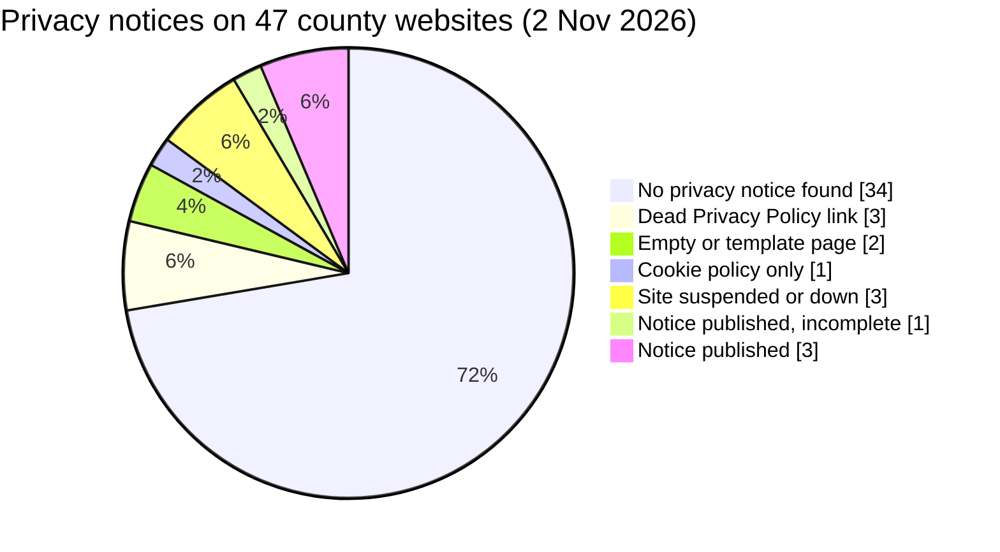

# Kenya County Privacy Review 2026

**Do Kenya's 47 county governments tell citizens how they use their personal data?**

An independent review of privacy notices on every county government website, measured against the Data Protection Act 2019, together with a check of the Office of the Data Protection Commissioner (ODPC) register. Data collected on 2 November 2026.



## Key findings

* **Only 4 of 47 counties (9%)** publish a privacy notice that citizens can find from the homepage: Makueni, Narok, Laikipia and Siaya.
* **40 of the 44 websites that loaded (91%)** give citizens no usable privacy information.
* **Only 1 county (Laikipia)** gives a Data Protection Officer contact.
* **Signs of neglect:** 3 counties have a "Privacy Policy" link that goes nowhere, 2 have empty or template privacy pages, Siaya's notice still reads "[Insert Name/Office]", and 2 official county websites were suspended by their host.
* **The official directory is outdated:** the Council of Governors list sends visitors for Kwale and Machakos to old domains that now redirect to unrelated commercial websites.
* **ODPC registration is patchy:** 21 counties have at least one active registration, but mostly for a single department (often Agriculture). Only 4 are registered as a whole county government, and 3 county registrations have expired.

## Scores (out of 10)

| County | Score | Note |
|---|---|---|
| Makueni | 10 | Complete notice, contact office, ODPC complaint route |
| Narok | 9 | Most detailed notice, 72 hour breach commitment, no DPO |
| Laikipia | 8 | Only DPO desk and privacy email, no retention or ODPC route |
| Siaya | 8 | Detailed but published with unfilled placeholders |
| 43 others | 0 to 1 | No usable notice, site down or not assessed |

Full results for every county: [`data/county_websites_2026-11-02.csv`](data/county_websites_2026-11-02.csv)

## Read the study

* Full report: [`report/report.md`](report/report.md)
* Checklist and legal basis: [`methodology/checklist.md`](methodology/checklist.md)

## Repository contents

```
data/          Dataset for all 47 counties (CSV)
methodology/   Scoring checklist, legal references, method and limitations
report/        Full write-up with findings and recommendations
scripts/       Browser probe used to find privacy links, and a summary script
```

Reproduce the summary:

```bash
python scripts/summarise.py data/county_websites_2026-11-02.csv
```

## Method in brief

Each county homepage was opened in a browser and searched for privacy, data protection and cookie policy links, with common addresses such as `/privacy-policy/` tested where no link existed. Every notice found was read and scored against ten checks drawn from sections 24, 25, 26, 29, 39 and 56 of the Data Protection Act 2019. The ODPC register of 19,079 data handlers was searched for county governments, departments, public service boards and municipalities.

## Limitations

This is a snapshot of main county websites on one day. E-service portals were not reviewed, and a county may be registered with the ODPC under a name this search did not match.

## Author

**Beatrice Mwangi**, governance, risk and compliance professional, Nairobi.
[LinkedIn](https://www.linkedin.com/in/beatrice-warukira) · [GitHub](https://github.com/Secsiren)

Feedback and corrections are welcome. If a county has published or updated its notice, please open an issue.

## Licence

Data and report: [CC BY 4.0](https://creativecommons.org/licenses/by/4.0/). Code: MIT.
