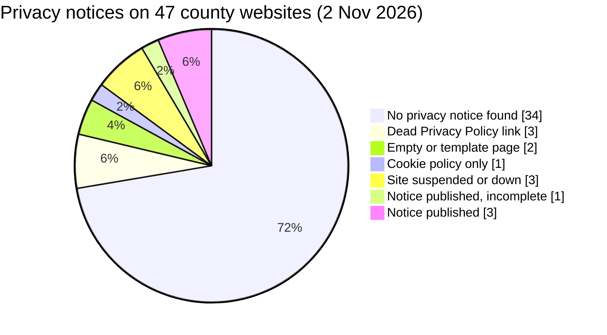

# How Kenya's county governments tell citizens about their personal data

**A review of privacy notices on the websites of all 47 county governments, measured against the Data Protection Act 2019**

Beatrice Mwangi · Nairobi · November 2026

---

## 1. Why this matters

County governments collect personal data every day. They handle revenue and business permits, health records, bursary applications, job applications and complaints. Since devolution in 2013, counties have become the part of the state that most Kenyans deal with directly.

The Data Protection Act 2019 says any organisation collecting personal data must first tell people why it is collected, who will receive it, how long it is kept, how it is protected and what their rights are (section 29). Public bodies are expected to appoint a Data Protection Officer (section 24), and county departments must register with the Office of the Data Protection Commissioner (ODPC) whatever their size.

A county's website is usually where citizens first meet the county online, and often where data collection starts. So a simple question says a lot about how seriously data protection is taken in practice: **does the county tell people, publicly and clearly, how it handles their personal data?**

## 2. Research questions

1. How many of Kenya's 47 county governments publish a privacy notice on their official website?
2. Where a notice exists, does it give citizens the information the Act requires?
3. Do county governments appear on the ODPC register of data controllers?
4. What does this suggest about data protection governance at county level?

## 3. Method

All 47 county websites listed by the Council of Governors were checked on **2 November 2026**. Each homepage was opened in a browser and searched for links to a privacy or data protection notice. Common addresses such as `/privacy-policy/` were tested where no link existed. Every notice found was read and scored against a 10 point checklist built from the Act (see `methodology/checklist.md`). Separately, the ODPC's public register of 19,079 registered data handlers was searched for county bodies.

The full dataset is in `data/county_websites_2026-11-02.csv`.

## 4. Findings

### 4.1 Most counties publish no privacy notice

| Result | Counties | Number |
|---|---|---|
| Notice published, complete | Makueni, Narok, Laikipia | 3 |
| Notice published, incomplete | Siaya | 1 |
| Cookie policy only | Mombasa | 1 |
| Empty page or default template, not linked | Machakos, Kajiado | 2 |
| "Privacy Policy" link that goes nowhere | Taita-Taveta, Isiolo, Migori | 3 |
| Website suspended or down | Turkana, Bomet, Nyeri | 3 |
| No privacy notice found | the remaining 34 counties | 34 |

Only **4 of 47 counties (9%)** publish a privacy notice that citizens can find from the homepage. Of the 44 websites that loaded, **40 (91%) give citizens no usable privacy information.**

### 4.2 Even published notices have gaps

| County | Score /10 | Strengths | Gaps |
|---|---|---|---|
| Makueni | 10 | Cites the Act, explains rights, retention and sharing, names a contact office (County Secretary), refers complaints to ODPC | No Data Protection Officer named |
| Narok | 9 | Most detailed notice (effective 1 June 2024, reviewed annually); commits to notify ODPC of breaches within 72 hours | Only a general info@ email, no DPO or privacy contact |
| Laikipia | 8 | Dated June 2026; the only county with a Data Protection Officer desk and a dedicated privacy email | No retention period, no route to complain to ODPC |
| Siaya | 8 | Detailed and well structured | Published with template placeholders still in it: "Data Protection Officer / Designated Privacy Contact: [Insert Name/Office]" |

Only **one county (Laikipia)** gives citizens a Data Protection Officer contact, and only **two** give any dedicated contact for data requests.

### 4.3 Signs of neglect, not just absence

Several findings point to websites that are set up but not maintained:

* **Dead privacy links.** Taita-Taveta, Isiolo and Migori show a "Privacy Policy" link in the footer that leads back to the homepage or nowhere. The link exists because the website template has it, but no one wrote the policy.
* **Placeholder and template text.** Kajiado's privacy page is the default WordPress text ("Our website address is..."). Machakos has a page titled "Privacy Policy" with nothing on it. Siaya's notice still says "[Insert Name/Office]".
* **Suspended websites.** Turkana's and Bomet's official websites showed a hosting "Account suspended" page on the review date.
* **Outdated official directory.** The Council of Governors' list of county websites points Kwale and Machakos to old domains that now redirect to unrelated commercial websites, and lists Nyeri with Mandera's address. A citizen following the official directory could land on a site that has nothing to do with government, which is a phishing and trust risk.

### 4.4 Registration with the Data Protection Commissioner is patchy

| ODPC register result | Counties |
|---|---|
| At least one active registration for the county government or a county department | 21 |
| Registration found but expired (Kiambu, Mombasa, Murang'a) | 3 |
| No match found | 23 |

Only four counties are registered as a whole "County Government of ..." (Kilifi, Kirinyaga, Migori and Uasin Gishu). In most other counties only one department is registered, most often Agriculture, which suggests registration has been driven by individual programmes rather than a county-wide approach. Three of the four counties with published notices (Narok, Laikipia and Siaya) were not found on the register under any county name, so a good notice and formal registration do not yet go together.

## 5. What this means for governance

1. **The law is ahead of practice.** Five years after the Act's registration regulations, most counties do not meet the most visible duty in the law: telling citizens how their data is used.
2. **Compliance is department by department, not county-wide.** Registration by single departments and missing Data Protection Officers point to no one owning data protection at county level.
3. **Digital services are growing faster than safeguards.** Counties are moving revenue, permits and health services online, but the basic transparency that should come with them is missing, and those who depend most on public services have the least ability to protect themselves.
4. **Good practice exists inside the system.** Makueni, Narok and Laikipia show that counties can do this with existing resources. Their notices could serve as a model for others through the Council of Governors.

## 6. Recommendations

**For county governments**
* Publish a short, plain language privacy notice linked from every page and every e-service, covering all eight items in section 29 of the Act.
* Appoint a Data Protection Officer and publish a working contact.
* Register the county government as a whole with the ODPC and keep registrations renewed.
* Remove dead "Privacy Policy" links and template text, which mislead citizens.

**For the Council of Governors**
* Share a model county privacy notice based on the Makueni, Narok and Laikipia examples.
* Correct the county website directory, especially the links that now lead to commercial sites.

**For the Office of the Data Protection Commissioner**
* Publish a list of registered public bodies so citizens can check their county's status.
* Prioritise awareness and compliance checks for county governments, which hold large amounts of citizens' personal data.

## 7. Limitations and next steps

This review only looked at main county websites on one day. It did not test e-service portals, paper forms or how counties actually handle data internally. Name matching on the ODPC register may miss registrations under unusual names. A next stage could review county e-service portals, request information under the Access to Information Act 2016, and interview county ICT officers and Data Protection Officers about the barriers they face.

## References

* Republic of Kenya. *Data Protection Act, No. 24 of 2019.*
* Republic of Kenya. *Data Protection (Registration of Data Controllers and Data Processors) Regulations, 2021.*
* Office of the Data Protection Commissioner. *Registered Data Handlers* (accessed 2 November 2026), odpc.go.ke.
* Council of Governors. *The 47 Counties* (accessed 2 November 2026), cog.go.ke.
* County government websites as listed in `data/county_websites_2026-11-02.csv` (accessed 2 November 2026).
